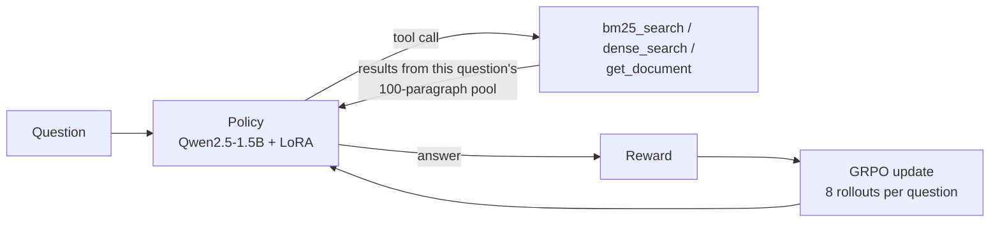

# AgentOS · SearchRL

**English** · [简体中文](README.zh-CN.md)

**SearchRL** trains a small language model to answer multi-hop questions with search tools, using reinforcement learning with verifiable rewards. The policy decides at each turn whether to run a keyword search, a semantic search, read a full paragraph, or answer, and it is rewarded for correct answers reached with fewer, cheaper tool calls. It is built on **AgentOS**, a multi-agent tool runtime in the same repository (part 2 below).

## Results

Qwen2.5-1.5B-Instruct + LoRA, trained with multi-turn GRPO on one RTX 4090. Evaluated on held-out data with 3 sampling seeds (temperature 0.7). The checkpoint was chosen on the dev set; the test set was used once.

| Dataset | EM before RL | EM after RL | Content-only gain¹ | Tool calls per question |
|---|---|---|---|---|
| HotpotQA test (500) | 6.6% ± 1.4% | **24.6% ± 0.6%** | +9.9 pts | 2.28 → **1.00** |
| 2WikiMultihopQA, not trained on (300) | 3.4% ± 1.7% | **18.6% ± 1.2%** | +10.2 pts | 3.05 → **1.00** |
| MuSiQue, not trained on (300) | 1.2% ± 0.7% | **7.3% ± 0.9%** | +2.2 pts | 2.00 → **1.00** |

¹ Gain in lenient EM, which also accepts an untagged final reply that contains the gold answer. It removes the part of the gain that comes from learning the `<answer>` format.

- **Answer quality and cost improve together**: the trained policy answers every question in the required format (no-answer rate 68% → 0% on test), makes 56% fewer tool calls and reads 16% fewer retrieved tokens.
- **The gain transfers** to 2WikiMultihopQA, which was never used in training, about as well as to HotpotQA itself.
- **Independent check**: verl's own validation during training (dev, greedy decoding) shows EM 15.0% → 25.0%, matching the content-only gain on test.
- **Known weakness**: the policy settles on a single search per question, so questions that need three or four hops (MuSiQue) improve little.

Full report with per-seed numbers, training curves and a reward-hacking review: [`results/rl_report.md`](results/rl_report.md) (Chinese). Every number can be recomputed from the saved trajectories with `scripts/rl_summarize.py`.

## How SearchRL works



| Part | Design |
|---|---|
| Data | HotpotQA distractor: train 8,000 / dev 300 / test 500 (dev and test from the official validation set, disjoint). 2WikiMultihopQA and MuSiQue (300 each) only for testing. Leakage checks in `results/rl_data_report.json` |
| Environment | Gym-style `reset(qid)` / `step(action)`. Each question searches its own pool: its 10 paragraphs plus distractors from other questions, with opaque document ids |
| Tools | `bm25_search` and `dense_search` (bge-small-en-v1.5) return short snippets; `get_document` returns a full paragraph and costs more tokens |
| Reward | Exact match, minus a penalty for malformed calls or a missing answer, minus a capped cost (calls and retrieved tokens) charged **only on correct answers**, minus a soft penalty beyond 6 turns, plus a capped bonus for retrieving the gold supporting paragraphs |
| Training | verl 0.9.1 multi-turn GRPO, FSDP2, LoRA r=32, lr 1e-5, KL 0.001, 8 questions × 8 rollouts per step, up to 8 turns; tool outputs are masked from the loss |
| Evaluation | `scripts/rl_eval.py` serves the model with vLLM and replays the same environment, tool text and reward as training; reports EM, F1, lenient EM, calls, tokens and turns as mean ± std over seeds |

Two design points mattered most in practice:

- **The cost penalty applies only to correct answers.** Otherwise answering without searching becomes the safest strategy. An early reward version without the format example and retrieval bonus did collapse to no-search answers, which shaped the final design.
- **Evaluation must show the model exactly the training prompt.** verl renders simplified tool definitions, and the evaluation reproduces that text character for character (there is a unit test for it).

## Reproducing SearchRL

Data preparation, environment tests and evaluation run on a laptop; training needs one 24GB GPU with CUDA 13 drivers.

```bash
make install
bash scripts/rl_download_raw.sh               # HotpotQA, 2Wiki, MuSiQue parquet files
.venv/bin/python scripts/rl_prepare_data.py   # splits, retrieval pools, leakage report
.venv/bin/python scripts/rl_make_verl_data.py
.venv/bin/python -m pytest -q tests/test_rl_env.py
```

On the GPU machine:

```bash
bash scripts/autodl_setup.sh                                  # verl 0.9.1, models, dense vectors
EXP=grpo_v11 ATTN=sdpa bash scripts/rl_train_grpo.sh          # GRPO with LoRA
MODEL=<base model> TAG=pre_rl SPLITS="test ood_2wiki ood_musique" bash scripts/rl_serve_and_eval.sh
MODEL=<base model> LORA=<run>/lora_adapter TAG=post_rl SPLITS="test ood_2wiki ood_musique" bash scripts/rl_serve_and_eval.sh
```

Step-by-step guide with checks after each stage: [`docs/rl_runbook.md`](docs/rl_runbook.md) (Chinese).

**Limitations**: one training run (50 steps); no ablations yet (cost penalty, DAPO components) and no large-model baseline; retrieval pools are easier than open-Wikipedia search; the base model may have seen HotpotQA during pre-training.

---

## Part 2: AgentOS multi-agent runtime

AgentOS is the tool runtime SearchRL grew out of. A goal is turned by an LLM planner into a DAG of agent subtasks; an event-driven scheduler (`asyncio.wait(FIRST_COMPLETED)`) runs independent subtasks in parallel; every tool call goes through MCP discovery, JSON Schema validation, tiered recovery (retry with backoff / argument repair / partial replan) and programmatic verification; state is checkpointed in SQLite so an interrupted task resumes without repeating confirmed side effects.

It comes with **AgentOS-TaskBench**, an end-to-end benchmark over a synthetic enterprise world (orders, inventory, refunds, policies; 7 MCP servers, 23 tools) graded by code. In a pilot on 18 unseen test tasks with `qwen3.8-max-0902`, AgentOS matched a ReAct baseline's success rate (0.944) with 54% fewer tokens, and beat a fixed-role multi-agent baseline (0.667) with 60% fewer tokens. n = 18 is small; details in [`docs/taskbench.md`](docs/taskbench.md) and [`docs/experiment_report.md`](docs/experiment_report.md) (Chinese).

Try it offline with the mock model:

```bash
make test                                           # 76 tests, fully offline
make demo                                           # small DAG with checkpointing
make mcp-smoke                                      # real MCP protocol, in memory
make taskbench-dry                                  # benchmark task mix; sends no request
```

To use a real model, copy `.env.example` to `.env` (git-ignored) and set either `AGENTOS_PROVIDER=bailian` with `DASHSCOPE_API_KEY`, or `AGENTOS_PROVIDER=openai_compatible` with `AGENTOS_BASE_URL` and `AGENTOS_API_KEY`. See [`docs/bailian_api.md`](docs/bailian_api.md).

## Repository layout

| Path | Contents |
|---|---|
| `agentos/rl/` | SearchRL: data preparation, environment, tools, reward, evaluation, verl adapter |
| `scripts/rl_*.sh`, `scripts/rl_*.py`, `scripts/autodl_setup.sh` | SearchRL data, training, evaluation and analysis |
| `results/` | SearchRL report, evaluation trajectories, training curves and validation records |
| `agentos/runtime/`, `agentos/agents/` | AgentOS planner, scheduler, executor, verifier, recovery, checkpoints |
| `agentos/world/`, `agentos/taskbench/`, `agentos/baselines/` | Synthetic enterprise world, TaskBench and its ReAct / fixed-role baselines |
| `agentos/llm/`, `agentos/mcp/`, `agentos/rag/` | Model providers, MCP client, retrieval baselines |
| `experiments/results/` | TaskBench and earlier benchmark outputs |
| `docs/` | Runbook, design notes and reports (mostly Chinese) |
| `tests/` | 76 unit tests |

## Data and licenses

- HotpotQA distractor (Yang et al., 2018), CC BY-SA 4.0. MuSiQue (Trivedi et al., 2022), CC BY 4.0. 2WikiMultihopQA (Ho et al., 2020): downloaded from a Hugging Face mirror; check the upstream license before redistribution. Raw files are downloaded by script and not stored in the repository; their SHA-256 checksums are in `results/rl_data_report.json`.
- `benchmarks/real_data/` holds small HotpotQA and BFCL v4 (Apache-2.0) subsets used by AgentOS, with source ids and checksums.
- The TaskBench enterprise world is synthetic and marked `synthetic: true`.

## License

Code is released under the [MIT License](LICENSE). Datasets keep their original licenses.
