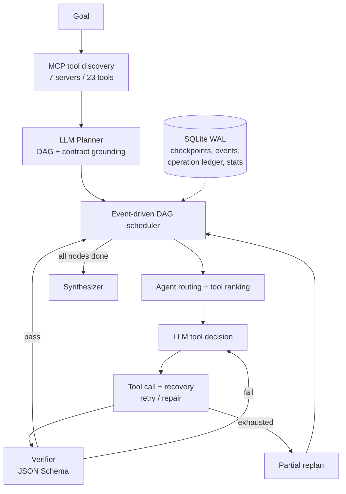

# AgentOS

**English** · [简体中文](README.zh-CN.md)

AgentOS is a research runtime for multi-agent task execution. You submit a goal; an LLM planner turns it into a DAG of agent subtasks, an event-driven scheduler runs independent subtasks in parallel, and every tool call goes through MCP discovery, JSON Schema checks, tiered recovery (retry / repair / replan) and programmatic verification. State is checkpointed in SQLite, so an interrupted task can resume without repeating confirmed side effects.

The repository also contains **AgentOS-TaskBench**, an end-to-end benchmark with a synthetic enterprise world (orders, inventory, refunds, policies) and HotpotQA questions, graded by code rather than by an LLM judge.

## Highlights

- **Planner → DAG**: one LLM call decomposes the goal into subtasks with explicit dependencies. The plan is then *grounded* in code: unknown tools are dropped, each subtask is assigned an agent that is allowed to use its tool, and acceptance criteria come from the tool's real output schema rather than from the model.
- **Event-driven scheduling**: `asyncio.wait(FIRST_COMPLETED)` starts a node as soon as its own dependencies succeed, instead of waiting for a whole level.
- **Agent routing and tool ranking**: agents are filtered by capability and scored on relevance, Beta-posterior success rate, token cost and latency (with ε-greedy exploration). Tools are ranked by relevance, observed success and latency; the LLM picks one of the top 5.
- **Tiered recovery**: errors are classified first. Transient errors get exponential backoff with jitter, bad arguments are repaired by the LLM, failed verification re-runs the node with feedback, and exhausted nodes trigger a partial replan that keeps successful nodes. Auth errors fail fast.
- **Side-effect safety**: tools carry MCP annotations (read-only / idempotent / side effect). An operation ledger keyed by `operation_id` prevents replaying confirmed operations after a crash, and a side-effecting node that fails verification goes to manual review instead of being retried.
- **Honest evaluation**: dev/test splits are entity-disjoint, all synthetic tasks are marked `synthetic: true`, and results are reported with confidence intervals and paired tests.

## Architecture



## Results

Pilot evaluation on **18 test tasks** that were not used during debugging (two per task family, including two HotpotQA questions), model `qwen3.8-max-0902`, temperature 0, one repeat. Raw records: [`experiments/results/taskbench/test_max_fresh/`](experiments/results/taskbench/test_max_fresh/).

| Method | Success rate (95% CI) | Avg tokens | P95 latency |
|---|---|---|---|
| ReAct (native function calling, all 23 tools) | 0.944 (0.83–1.00) | 14,948 | 46.0 s |
| Fixed roles (researcher → analyst → support, then writer) | 0.667 (0.44–0.89) | 16,922 | 95.4 s |
| **AgentOS** | **0.944** (0.83–1.00) | **6,853** | 53.9 s |

- vs ReAct: same success rate (McNemar p = 0.48) with 54.2% fewer tokens; P95 latency is 17.2% higher because of the planning and synthesis calls.
- vs fixed roles: +27.8 points success rate (bootstrap CI +0.05 to +0.56; McNemar p = 0.13, not significant at 0.05), 59.5% fewer tokens, 43.5% lower P95 latency.

An earlier pilot on `qwen3.8-27b`, run *before* several fixes, is kept for the record: AgentOS reached only 0.556 there, mainly because of malformed final-answer JSON. Those 18 tasks were then retired and the fixed version was evaluated on unseen tasks. The full history and the failure analysis are in [`docs/experiment_report.md`](docs/experiment_report.md) (Chinese).

**Limits:** n = 18 is small, the enterprise world is synthetic, and the task generator and tools were written by the same author. All three methods use the same tools, the same fault injection and the same programmatic grader.

## Repository layout

| Path | Contents |
|---|---|
| `agentos/runtime/` | Service orchestration, DAG utilities, scheduler, checkpoint store, routing, recovery |
| `agentos/agents/` | Planner, Executor, Verifier, Synthesizer, agent profiles |
| `agentos/world/` | Synthetic enterprise world and its 7 MCP servers |
| `agentos/taskbench/` | Task generator, HotpotQA adapter, fault injection, grading, statistics |
| `agentos/baselines/` | ReAct and fixed-role baselines |
| `agentos/llm/` | Mock, OpenAI-compatible and Bailian (DashScope) providers |
| `agentos/mcp/` | MCP client provider and the legacy demo servers |
| `agentos/benchmarks/`, `agentos/rag/` | Older offline routing micro-benchmark and retrieval baselines |
| `benchmarks/` | Generated task files and public-data subsets (with provenance metadata) |
| `experiments/results/` | Raw outputs of the runs cited in the docs |
| `docs/` | Design notes, benchmark description, experiment report (mostly Chinese) |
| `tests/` | 58 unit tests (recovery, idempotency, failure branches, grading) |

## Quick start (no API key needed)

Requirements: Python 3.11+, `make`, and network access to PyPI for the first install.

```bash
git clone https://github.com/zibinghou742-gif/agentos.git
cd agentos
make install        # creates .venv, installs a pinned uv, syncs uv.lock
make test           # 58 tests, fully offline
```

Try the runtime with the offline mock model:

```bash
make demo                                          # small DAG with checkpointing
.venv/bin/python scripts/run_e2e_example.py --dry-run
make mcp-smoke                                     # real MCP protocol, in memory
make taskbench-dry                                 # show the benchmark task mix; sends no request
```

## Using a real model

1. Copy the template and add your key. `.env` is git-ignored; never commit it.

   ```bash
   cp .env.example .env
   ```

2. Pick a provider in `.env`:

   - **Alibaba Cloud Bailian (DashScope)**, used for the reported results:

     ```dotenv
     AGENTOS_PROVIDER=bailian
     AGENTOS_MODEL=qwen3.8-max-0902
     DASHSCOPE_API_KEY=sk-...
     AGENTOS_ENABLE_THINKING=false
     ```

     The endpoint is inferred from the key type. See [`docs/bailian_api.md`](docs/bailian_api.md).

   - **Any OpenAI-compatible endpoint**:

     ```dotenv
     AGENTOS_PROVIDER=openai_compatible
     AGENTOS_BASE_URL=https://api.example.com/v1
     AGENTOS_API_KEY=...
     AGENTOS_MODEL=<model-name>
     ```

     Delete the `AGENTOS_ENABLE_THINKING` line for non-Qwen endpoints; when it is set, the flag is sent in the request body.

3. Check the configuration, then make one small call:

   ```bash
   .venv/bin/python scripts/check_bailian.py --dry-run
   make api-check
   ```

## Running TaskBench

Every command below calls the real model and costs tokens. `--token-budget` stops launching new runs once the budget is spent, and tasks run task-major so that partial runs still give complete comparisons.

```bash
# Debug run on the dev split: one task per family, AgentOS only
.venv/bin/python scripts/run_taskbench.py --split dev --per-family 1 --methods agentos \
  --token-budget 150000 --output experiments/results/taskbench/my_dev/runs.jsonl

# Reproduce the reported test run (about 700K tokens in total)
.venv/bin/python scripts/run_taskbench.py --split test --per-family 2 --skip-per-family 2 \
  --methods react,fixed_roles,agentos --token-budget 900000 \
  --output experiments/results/taskbench/my_test/runs.jsonl
```

`--skip-per-family 2` skips the first two tasks of each family, which were inspected during debugging. Results are appended line by line, so an interrupted run resumes when rerun with the same `--output`. A `summary.json` with per-method metrics and paired tests is written next to `runs.jsonl`. The script refuses to report results produced by the mock provider.

The benchmark files in `benchmarks/taskbench/` are generated deterministically; `make taskbench-data` rebuilds them. More detail: [`docs/taskbench.md`](docs/taskbench.md).

## HTTP API

```bash
make api
curl -X POST http://127.0.0.1:8000/api/tasks \
  -H 'Content-Type: application/json' \
  -d '{"goal": "What is the warranty period and list price of Edge Runner?"}'
curl http://127.0.0.1:8000/api/tasks/<task_id>
curl http://127.0.0.1:8000/api/tasks/<task_id>/trace
```

## Other experiments

- `make benchmark && make evaluate`: offline tool-routing micro-benchmark (no LLM; heuristic routing only).
- `make real-data && make real-benchmark`: BFCL v4 / HotpotQA subsets and local baselines. See [`docs/real_benchmark.md`](docs/real_benchmark.md).
- `scripts/train_lightweight_embedding.py`: small metric-learning smoke test. It showed no improvement, as reported in the experiment report.
- `examples/`: LangGraph and AgentScope comparison demos. AgentScope needs its own environment (`examples/agentscope-requirements.txt`).

## Data and licenses

- The enterprise world and TaskBench synthetic tasks are generated by this repository and marked `synthetic: true`.
- `benchmarks/real_data/` contains subsets of public datasets. Each record keeps its source id, and `METADATA.json` records URLs and SHA-256 checksums:
  - HotpotQA distractor (Yang et al., 2018), CC BY-SA 4.0
  - BFCL v4 live-multiple (Gorilla project), Apache-2.0

## License

Code is released under the [MIT License](LICENSE). Public-data subsets keep their original licenses listed above.
