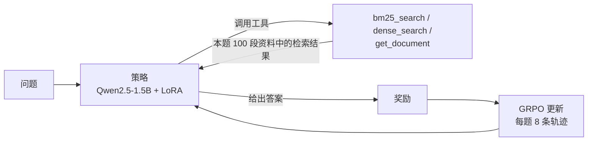

# AgentOS · SearchRL

[English](README.md) · **简体中文**

**SearchRL** 用"可验证奖励的强化学习"训练一个小模型：给它检索工具，让它回答多跳问题。每一轮，策略自己决定是做关键词搜索、语义搜索、读一整段原文，还是直接回答；**用更少、更便宜的工具调用答对**，得到的奖励更高。它建立在同一个仓库里的多智能体工具运行时 **AgentOS** 之上（见下文第二部分）。

## 实验结果

Qwen2.5-1.5B-Instruct + LoRA，在一张 RTX 4090 上用多轮 GRPO 训练。在没参与训练和调参的数据上评测，3 个采样 seed（temperature 0.7）。检查点按 dev 成绩选择，test 只用了一次。

| 数据集 | RL 前 EM | RL 后 EM | 内容上的提升¹ | 每题工具调用次数 |
|---|---|---|---|---|
| HotpotQA test（500 题） | 6.6% ± 1.4% | **24.6% ± 0.6%** | +9.9 个百分点 | 2.28 → **1.00** |
| 2WikiMultihopQA，未训练（300 题） | 3.4% ± 1.7% | **18.6% ± 1.2%** | +10.2 个百分点 | 3.05 → **1.00** |
| MuSiQue，未训练（300 题） | 1.2% ± 0.7% | **7.3% ± 0.9%** | +2.2 个百分点 | 2.00 → **1.00** |

¹ 宽松 EM 的提升：没有写 `<answer>` 标签时，只要最后一轮回复里包含标准答案也算对。这样可以去掉"学会答案格式"带来的那部分提升。

- **答得更准，同时更省**：训练后的策略每题都按要求格式作答（test 上不答题比例从 68% 降到 0%），工具调用减少 56%，读到的检索内容减少 16%。
- **能迁移到没见过的数据集**：在训练中从未使用的 2WikiMultihopQA 上，提升幅度和 HotpotQA 本身差不多。
- **独立验证**：训练过程中 verl 自己在 dev 上的验证（贪心解码）显示 EM 从 15.0% 提升到 25.0%，和 test 上"内容上的提升"一致。
- **已知不足**：策略最后固定成"每题只搜 1 次"，所以需要 3–4 跳的 MuSiQue 提升很小。

完整报告（每个 seed 的数字、训练曲线、reward hacking 检查）见 [`results/rl_report.md`](results/rl_report.md)。所有数字都可以用 `scripts/rl_summarize.py` 从保存的轨迹重新算出来。

## SearchRL 的工作方式



| 部分 | 设计 |
|---|---|
| 数据 | HotpotQA distractor：train 8000 / dev 300 / test 500（dev 和 test 来自官方验证集，互不重叠）。2WikiMultihopQA 和 MuSiQue 各 300 题，只用于测试。泄漏检查见 `results/rl_data_report.json` |
| 环境 | Gym 风格的 `reset(qid)` / `step(action)`。每道题只在自己的段落池里检索：本题的 10 段，加上其他题目的干扰段落，文档 id 不透明 |
| 工具 | `bm25_search` 和 `dense_search`（bge-small-en-v1.5）返回短摘要；`get_document` 返回整段原文，消耗的 token 更多 |
| 奖励 | 完全匹配得分；工具调用格式错误、没有给出答案要扣分；**只对答对的回合**按调用次数和读取的 token 扣成本分（有上限）；超过 6 轮软扣分；检索到标准支撑段落有少量加分（有上限） |
| 训练 | verl 0.9.1 多轮 GRPO，FSDP2，LoRA r=32，学习率 1e-5，KL 0.001，每步 8 题 × 8 条轨迹，最多 8 轮；工具返回的内容不计入 loss |
| 评测 | `scripts/rl_eval.py` 用 vLLM 启动模型，重放和训练时完全相同的环境、工具文本和奖励；报告 EM、F1、宽松 EM、调用次数、token 和轮数，给出各 seed 的均值 ± 标准差 |

实践中最关键的两个设计：

- **成本扣分只作用于答对的回合。** 否则"不检索直接回答"会成为最保险的策略。早期一版奖励没有格式示例和检索加分，确实坍缩成了不检索直接作答，最终的设计就是由此确定的。
- **评测时，模型看到的提示词必须和训练时一模一样。** verl 会精简工具定义，评测会逐字复现同样的文本（有单元测试保证）。

## 复现 SearchRL

数据准备、环境测试和评测在普通电脑上就能做；训练需要一张 24GB、驱动支持 CUDA 13 的 GPU。

```bash
make install
bash scripts/rl_download_raw.sh               # 下载 HotpotQA、2Wiki、MuSiQue
.venv/bin/python scripts/rl_prepare_data.py   # 划分数据、生成检索池和泄漏报告
.venv/bin/python scripts/rl_make_verl_data.py
.venv/bin/python -m pytest -q tests/test_rl_env.py
```

在 GPU 机器上：

```bash
bash scripts/autodl_setup.sh                                  # 安装 verl 0.9.1、下载模型、计算向量
EXP=grpo_v11 ATTN=sdpa bash scripts/rl_train_grpo.sh          # LoRA + GRPO 训练
MODEL=<原始模型> TAG=pre_rl SPLITS="test ood_2wiki ood_musique" bash scripts/rl_serve_and_eval.sh
MODEL=<原始模型> LORA=<训练输出>/lora_adapter TAG=post_rl SPLITS="test ood_2wiki ood_musique" bash scripts/rl_serve_and_eval.sh
```

每一步的详细说明和检查方法见 [`docs/rl_runbook.md`](docs/rl_runbook.md)。

**局限**：只训练了一次（50 步）；还没有做消融实验（成本扣分、DAPO 组件），也没有大模型对照；检索池比全维基检索容易；基础模型可能在预训练中见过 HotpotQA。

---

## 第二部分：AgentOS 多智能体运行时

AgentOS 是 SearchRL 的前身，一个工具运行时。LLM Planner 把目标拆成多个 agent 子任务组成的 DAG；事件驱动的调度器（`asyncio.wait(FIRST_COMPLETED)`）并行执行互不依赖的子任务；每次工具调用都要经过 MCP 工具发现、JSON Schema 校验、分级恢复（带退避的重试 / 参数修复 / 局部重规划）和程序化验收；状态保存在 SQLite 中，任务中断后可以恢复，已确认的副作用不会重复执行。

配套的 **AgentOS-TaskBench** 是一个端到端评测集，基于一个合成的企业业务世界（订单、库存、退款、政策；7 个 MCP server、23 个工具），由程序判分。在 18 道未参与调试的 test 任务上（`qwen3.8-max-0902`）做的试点评测中，AgentOS 和 ReAct 基线成功率相同（0.944），token 少 54%；比固定角色多 agent 基线（0.667）高，token 少 60%。样本量 n = 18 偏小，详见 [`docs/taskbench.md`](docs/taskbench.md) 和 [`docs/experiment_report.md`](docs/experiment_report.md)。

用离线 mock 模型试运行：

```bash
make test                                           # 76 个测试，完全离线
make demo                                           # 带检查点的小型 DAG
make mcp-smoke                                      # 内存中走真实 MCP 协议
make taskbench-dry                                  # 查看评测任务构成，不发请求
```

要使用真实模型，把 `.env.example` 复制为 `.env`（已被 git 忽略），然后设置 `AGENTOS_PROVIDER=bailian` 和 `DASHSCOPE_API_KEY`；或者设置 `AGENTOS_PROVIDER=openai_compatible`、`AGENTOS_BASE_URL` 和 `AGENTOS_API_KEY`。详见 [`docs/bailian_api.md`](docs/bailian_api.md)。

## 目录结构

| 路径 | 内容 |
|---|---|
| `agentos/rl/` | SearchRL：数据准备、环境、工具、奖励、评测、verl 适配 |
| `scripts/rl_*.sh`、`scripts/rl_*.py`、`scripts/autodl_setup.sh` | SearchRL 的数据、训练、评测和分析脚本 |
| `results/` | SearchRL 报告、评测轨迹、训练曲线和验证记录 |
| `agentos/runtime/`、`agentos/agents/` | AgentOS 的 Planner、调度器、执行器、验收、恢复、检查点 |
| `agentos/world/`、`agentos/taskbench/`、`agentos/baselines/` | 合成企业世界、TaskBench 及其 ReAct / 固定角色基线 |
| `agentos/llm/`、`agentos/mcp/`、`agentos/rag/` | 模型 provider、MCP 客户端、检索基线 |
| `experiments/results/` | TaskBench 和更早的评测输出 |
| `docs/` | 上机手册、设计说明和报告 |
| `tests/` | 76 个单元测试 |

## 数据与许可证

- HotpotQA distractor（Yang et al., 2018），CC BY-SA 4.0；MuSiQue（Trivedi et al., 2022），CC BY 4.0；2WikiMultihopQA（Ho et al., 2020）从 Hugging Face 镜像下载，再分发前请确认原始许可证。原始文件由脚本下载，不存放在仓库里，SHA-256 校验值记录在 `results/rl_data_report.json`。
- `benchmarks/real_data/` 中是 AgentOS 使用的少量 HotpotQA 和 BFCL v4（Apache-2.0）子集，保留了来源 id 和校验值。
- TaskBench 的企业世界是合成数据，标注了 `synthetic: true`。

## 许可证

代码使用 [MIT License](LICENSE)。数据集沿用各自的原始许可证。
