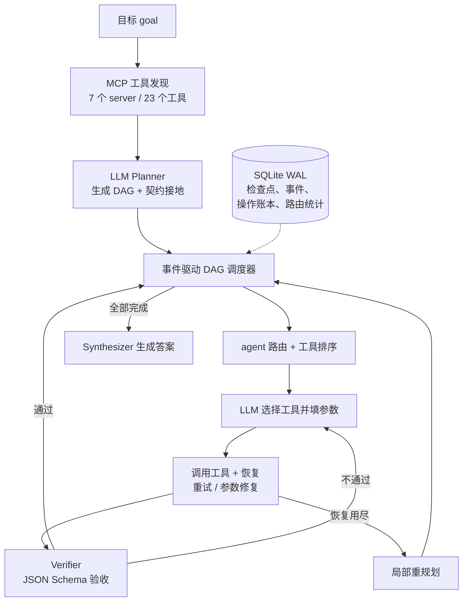

# AgentOS

[English](README.md) · **简体中文**

AgentOS 是一个多智能体任务运行时的研究实现。用户只提交一个目标（goal）：LLM Planner 把它拆成由多个 agent 子任务组成的 DAG，事件驱动的调度器并行执行互不依赖的子任务。每次工具调用都要经过 MCP 工具发现、JSON Schema 校验、分级恢复（重试 / 参数修复 / 重规划）和程序化验收。运行状态保存在 SQLite 中，任务中断后可以恢复，已经确认过的副作用不会重复执行。

仓库里还有 **AgentOS-TaskBench**：一个端到端评测集，包含一个合成的企业业务世界（订单、库存、退款、政策文档）和 HotpotQA 问答题，全部由程序判分，不用 LLM 当裁判。

## 主要特点

- **Planner → DAG**：一次 LLM 调用把目标拆成带依赖关系的子任务。之后由代码"接地"：删掉不存在的工具，给每个子任务分配有权限使用该工具的 agent；验收标准取自工具真实的输出 schema，不用模型自己猜的。
- **事件驱动调度**：用 `asyncio.wait(FIRST_COMPLETED)`，节点的依赖一满足就启动，不用等整层完成。
- **agent 路由与工具排序**：agent 先按能力过滤，再综合语义相关度、Beta 后验成功率、Token 成本和延迟打分（带 ε-greedy 探索）。工具按相关度、历史成功率和延迟排序，由 LLM 从前 5 个候选里选一个。
- **分级恢复**：先给错误分类。临时错误用带抖动的指数退避重试；参数错误由 LLM 修复；验收失败时带着反馈重跑节点；本地恢复手段用尽后做局部重规划，已成功的节点保留不动。鉴权错误直接失败，不浪费 token。
- **副作用安全**：工具带 MCP 标注（只读 / 幂等 / 有副作用）。以 `operation_id` 为键的操作账本，保证崩溃恢复后不会重放已确认的操作；有副作用的节点验收失败时，转人工处理，不会重试。
- **如实评测**：dev / test 按实体隔离，所有合成任务都标了 `synthetic: true`，结果附带置信区间和配对检验。

## 架构



## 实验结果

试点评测：**18 条调试中没有用过的 test 任务**（每个任务族 2 条，其中 2 条是 HotpotQA）。模型 `qwen3.8-max-0902`，temperature 0，跑 1 次。原始记录在 [`experiments/results/taskbench/test_max_fresh/`](experiments/results/taskbench/test_max_fresh/)。

| 方法 | 成功率（95% CI） | 平均 token | P95 延迟 |
|---|---|---|---|
| ReAct（原生 function calling，可用全部 23 个工具） | 0.944（0.83–1.00） | 14,948 | 46.0 秒 |
| 固定角色（研究员 → 分析员 → 客服，最后由 writer 汇总） | 0.667（0.44–0.89） | 16,922 | 95.4 秒 |
| **AgentOS** | **0.944**（0.83–1.00） | **6,853** | 53.9 秒 |

- 对比 ReAct：成功率持平（McNemar p = 0.48），token 少 54.2%；P95 延迟高 17.2%，原因是多了规划和答案合成两次调用。
- 对比固定角色：成功率高 27.8 个百分点（bootstrap CI +0.05 到 +0.56；McNemar p = 0.13，未达到 0.05 显著），token 少 59.5%，P95 延迟低 43.5%。

更早的一轮试点在 `qwen3.8-27b` 上进行，当时还没有做几项修复，结果也保留了：AgentOS 只有 0.556，主要原因是最终答案的 JSON 格式不合规。那 18 条任务看过失败原因之后就不再使用，修复后的版本换到没见过的任务上重测。完整过程和失败分析见 [`docs/experiment_report.md`](docs/experiment_report.md)。

**局限：** 样本量 n = 18 比较小；企业世界是合成的；任务生成器和工具出自同一作者。三种方法使用相同的工具、相同的故障注入和相同的程序化判分。

## 目录结构

| 路径 | 内容 |
|---|---|
| `agentos/runtime/` | 服务编排、DAG 工具函数、调度器、检查点存储、路由、恢复 |
| `agentos/agents/` | Planner、Executor、Verifier、Synthesizer、agent 角色定义 |
| `agentos/world/` | 合成企业世界和它的 7 个 MCP server |
| `agentos/taskbench/` | 任务生成、HotpotQA 适配、故障注入、判分、统计 |
| `agentos/baselines/` | ReAct 和固定角色两个基线 |
| `agentos/llm/` | Mock、OpenAI 兼容接口和百炼（DashScope）provider |
| `agentos/mcp/` | MCP client provider 和早期的演示 server |
| `agentos/benchmarks/`、`agentos/rag/` | 早期的离线路由微基准和检索基线 |
| `benchmarks/` | 生成的任务文件和公开数据子集（附来源信息） |
| `experiments/results/` | 文档里引用的各次运行的原始输出 |
| `docs/` | 设计说明、评测说明、实验报告 |
| `tests/` | 58 个单元测试（恢复、幂等、失败分支、判分） |

## 快速开始（不需要 API Key）

环境要求：Python 3.11+、`make`；第一次安装需要能访问 PyPI。

```bash
git clone https://github.com/zibinghou742-gif/agentos.git
cd agentos
make install        # 创建 .venv，安装固定版本的 uv，按 uv.lock 同步依赖
make test           # 58 个测试，完全离线
```

用离线 mock 模型试运行：

```bash
make demo                                          # 带检查点的小型 DAG
.venv/bin/python scripts/run_e2e_example.py --dry-run
make mcp-smoke                                     # 内存中走真实 MCP 协议
make taskbench-dry                                 # 查看评测任务构成，不发请求
```

## 使用真实模型

1. 复制配置模板，填入你自己的 key。`.env` 已被 git 忽略，**不要提交它**。

   ```bash
   cp .env.example .env
   ```

2. 在 `.env` 里选择 provider：

   - **阿里云百炼（DashScope）**，本文的实验结果用的就是它：

     ```dotenv
     AGENTOS_PROVIDER=bailian
     AGENTOS_MODEL=qwen3.8-max-0902
     DASHSCOPE_API_KEY=sk-...
     AGENTOS_ENABLE_THINKING=false
     ```

     接口地址会根据 key 的类型自动选择，详见 [`docs/bailian_api.md`](docs/bailian_api.md)。

   - **任何 OpenAI 兼容接口**：

     ```dotenv
     AGENTOS_PROVIDER=openai_compatible
     AGENTOS_BASE_URL=https://api.example.com/v1
     AGENTOS_API_KEY=...
     AGENTOS_MODEL=<模型名>
     ```

     用的不是 Qwen 系列接口时，请删掉 `AGENTOS_ENABLE_THINKING` 这一行。只要设置了它，这个参数就会被放进请求体里发出去。

3. 先检查配置，再发一次小额调用：

   ```bash
   .venv/bin/python scripts/check_bailian.py --dry-run
   make api-check
   ```

## 运行 TaskBench

下面的命令都会调用真实模型，会消耗 token。`--token-budget` 表示花到这个预算后，不再启动新的任务。任务按"一条任务跑完所有方法，再跑下一条"的顺序执行，所以即使中途停止，已完成的任务也有完整的对比。

```bash
# dev 上调试：每个任务族 1 条，只跑 AgentOS
.venv/bin/python scripts/run_taskbench.py --split dev --per-family 1 --methods agentos \
  --token-budget 150000 --output experiments/results/taskbench/my_dev/runs.jsonl

# 复现文中的 test 结果（总共约 70 万 token）
.venv/bin/python scripts/run_taskbench.py --split test --per-family 2 --skip-per-family 2 \
  --methods react,fixed_roles,agentos --token-budget 900000 \
  --output experiments/results/taskbench/my_test/runs.jsonl
```

`--skip-per-family 2` 会跳过每个任务族的前 2 条，因为这些在调试时已经看过了。结果逐行追加写入，中断后用同一个 `--output` 再运行一次，就会接着跑。`runs.jsonl` 旁边会生成 `summary.json`，里面有各方法的指标和配对检验。脚本不会把 mock provider 的结果当作评测结果输出。

`benchmarks/taskbench/` 里的任务文件是确定性生成的，可以用 `make taskbench-data` 重新生成。详见 [`docs/taskbench.md`](docs/taskbench.md)。

## HTTP API

```bash
make api
curl -X POST http://127.0.0.1:8000/api/tasks \
  -H 'Content-Type: application/json' \
  -d '{"goal": "What is the warranty period and list price of Edge Runner?"}'
curl http://127.0.0.1:8000/api/tasks/<task_id>
curl http://127.0.0.1:8000/api/tasks/<task_id>/trace
```

## 其他实验

- `make benchmark && make evaluate`：离线的工具路由微基准，不调用 LLM，只比较几种启发式路由规则。
- `make real-data && make real-benchmark`：BFCL v4 / HotpotQA 子集和本地基线，详见 [`docs/real_benchmark.md`](docs/real_benchmark.md)。
- `scripts/train_lightweight_embedding.py`：小规模 metric learning 冒烟实验。实验报告里如实记录了：它没有带来提升。
- `examples/`：LangGraph 和 AgentScope 的对照示例。AgentScope 需要单独的环境（见 `examples/agentscope-requirements.txt`）。

## 数据与许可证

- 企业世界和 TaskBench 的合成任务都由本仓库代码生成，标注为 `synthetic: true`。
- `benchmarks/real_data/` 包含公开数据集的子集。每条记录都保留了来源 ID，`METADATA.json` 里记录了下载地址和 SHA-256 校验值：
  - HotpotQA distractor（Yang et al., 2018），CC BY-SA 4.0
  - BFCL v4 live-multiple（Gorilla 项目），Apache-2.0

## 许可证

代码使用 [MIT License](LICENSE)。公开数据子集沿用上面列出的原始许可证。
